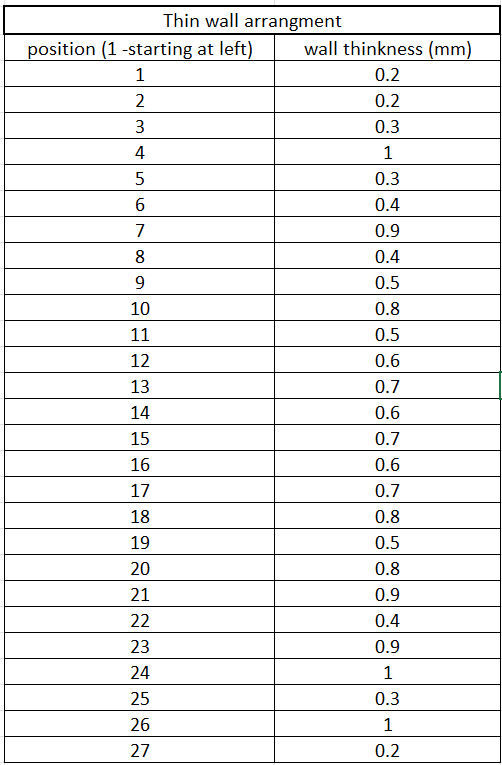
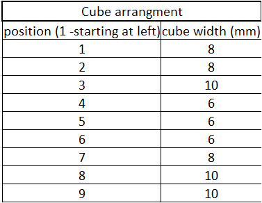

# Build Files

This folder contains CAD files and other process files used for the experiment.

## Build Plate Test Layout

## Thin Wall Arrangement

## Cube Arrangement

## CAD Files

CAD Assembly: `Assembly_test_02.iam`
